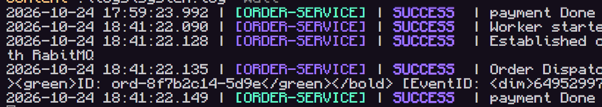

# OrderPlacementHappyPath
A system that only simulates the happy path of the backend logic for a e-commerce app. Using event based architecture and rabbit MQ.

## Execution

set up repo:
```
git clone https://github.com/InakiMedina/OrderPlacementHappyPath.git
cd OrderPlacementHappyPath
```

start docker and run order:
```
docker compose up -d --build
```

loggin:
```
Get-Content .\logs\system.log -Wait
```

clear logs and re run order
```
docker compose stop; Clear-Content .\logs\system.log; docker compose start; Get-Content .\logs\system.log -Wait
```


## Architecture

### Broker topology vs Mediator Topology
the exact arquitectures wasn't specificied. However the diagrams show a chorographed architecture. Since this isn't a real business there isn't alot to work on while making this desicions. So it comes down to the fact that Mediator Topology is for complex architectures so the correct one should be:

**Broker Topology**

### Kafka vs Rabbit MQ
Since this is my first time using any of the two, Rabbit MQ is easier to use and there is no real advantage of the complexity of Kafka for a simple happy path that rquires no logs or rollbacks.


**Rabbit MQ**

## Folder Structure

OrderPlacementHappyPath/
├── docker-compose.yml              # Orchestrates RabbitMQ, order placement, and consumers
├── README.md                       # Project documentation and architectural overview
│
├── services/
│   ├── orderPlacement/             # Order placement publisher service
│   │   ├── Dockerfile              # Container definition for the publisher
│   │   ├── requirements.txt        # Python dependencies (pika, etc.)
│   │   ├── app.py                  # Publisher script (reads order and emits event)
│   │   └── order.json              # Sample order payload (items, customer, payment)
│   │
│   └── payment/                    # Downstream consumer worker service
│       ├── Dockerfile              # Container definition for the consumer
│       ├── requirements.txt        # Python dependencies (pika, etc.)
│       └── app.py                  # Consumer worker (listens to queue, processes payment)
│
└── .gitignore                      # Git exclusion rules (pycache, volumes, .env)

## AI Usage

Gemini helped with the following
- troubleshooting docker
- helped me realized i don't need flask, just pika
- teach me docker
- teach me rabbit_mq reads and writes
- help deciding logging option
- teach me loguru
- teach me multiple rabbit_mq broker config options 
- show me how to connect to multiple brokers and config them
- debbug services everytime they stop reading the event
